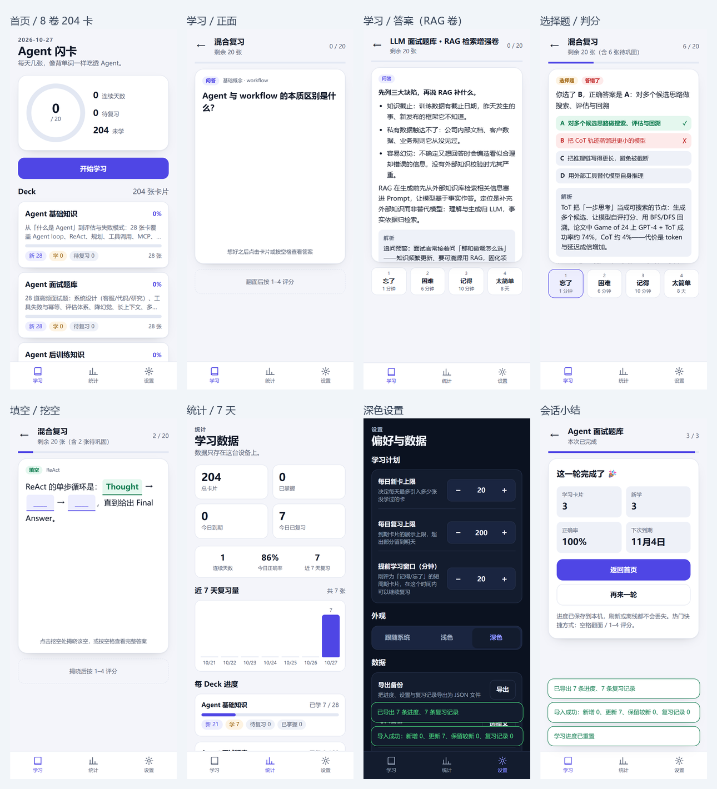

# Agent 闪卡 · 像背单词一样学 Agent

> 移动优先的 Agent 知识闪卡 PWA：**问答 / 选择题 / 填空** 三种卡型，**FSRS-6 间隔重复**，可安装、可离线，学习进度只存本机。  
> 8 个 deck · 204 张卡 · 全部中文 · 每张卡带可核验出处。



---

## 1. 这个仓库交付了什么

| 交付物 | 位置 | 说明 |
| --- | --- | --- |
| **GitHub 调研** | [docs/research/github-repos.md](docs/research/github-repos.md) | 20+ 候选（算法库/完整应用/UI/互操作）、stars/license/活跃度、复用方式与风险、ts-fsrs 实测 |
| **产品与内容设计** | [docs/01-product-design.md](docs/01-product-design.md) | 定位、用户、页面与交互、卡型与题库组织、学习流程、V1/V2 范围、指标 |
| **架构与技术选型** | [docs/02-architecture.md](docs/02-architecture.md) | 复用决策、分层、数据模型、FSRS 队列/日界/统计、PWA、三端与同步、安全、测试、风险 |
| **开发计划** | [docs/03-dev-plan.md](docs/03-dev-plan.md) | M0–M6 里程碑、任务拆解、验收项、验证命令、本次实测结果 |
| **可运行 App** | [`app/`](app/README.md) | Vite 8 + React 19 + TS + ts-fsrs 5.4.2 + Dexie + PWA；83 单测 + 51 项浏览器冒烟 |
| **题库内容** | [`content/`](content/README.md) | 8 个 deck / 204 卡（Agent 3 卷 + 大模型面试 5 卷）；schema、校验脚本、选题覆盖表、出处清单 |
| **来源地图** | [docs/research/llm-interview-source-map.md](docs/research/llm-interview-source-map.md) | 索引页识别、五卷划分、专题文章清单、制作规则 |
| **截图证据** | [docs/screenshots/](docs/screenshots/) | 首页、学习正反面、选择题、填空、统计、深色设置、会话小结、离线 |

---

## 2. 调研结论：复用 ts-fsrs，不 fork 完整应用

> 完整数据与逐项风险见 [docs/research/github-repos.md](docs/research/github-repos.md)（2026-10-26 实测）。

### 2.1 候选取舍

| 类别 | 代表 | 许可证 | 结论 |
| --- | --- | --- | --- |
| 调度算法 | [open-spaced-repetition/ts-fsrs](https://github.com/open-spaced-repetition/ts-fsrs)（835★，5.4.2 / FSRS-6） | MIT | **采用**（唯一同时满足 MIT + TS + 活跃 + API 完整 + 与 Anki 同源） |
| 完整应用 | [ankitects/anki](https://github.com/ankitects/anki)（约 3.2 万★）、[AnkiDroid](https://github.com/ankidroid/Anki-Android)（1.2 万★） | AGPL-3.0 / GPL-3.0 | 仅参考交互；许可证传染 + Rust/Kotlin 栈不匹配 |
| 参考实现 | [designfuchen/word-atlas](https://github.com/designfuchen/word-atlas)（1,485★） | 代码 MIT / 数据 CC BY 4.0 | **最接近的产品验证**：React 19 + Vite + ts-fsrs + 本地优先；不 fork（雅思插画/音频管线不匹配） |
| 中文背单词 | [word-wind](https://github.com/heygsc/word-wind)（325★，无 LICENSE）、[qwerty-learner](https://github.com/RealKai42/qwerty-learner)（2.3 万★，GPL-3.0） | 无证 / GPL | 流程可借鉴；代码不可合规复用 |
| 内容互操作 | [anki-apkg-export](https://github.com/repeat-space/anki-apkg-export)（182★，MIT） | MIT | V2 导出 Anki TSV/APKG；先做 TSV（APKG 需 Node ≥22.12 + sql.js WASM） |

### 2.2 推荐复用路径

**ts-fsrs（算法） + Dexie（IndexedDB） + vite-plugin-pwa（离线/安装） + 自研移动端 UI 薄壳 + 自有 JSON 内容格式（预留 Anki 导出）。**

关键依据：

- ts-fsrs 零运行时依赖，ESM 61KB / gzip 13.5KB，已实测四档调度：新卡 **Again 1 分钟 / Hard 6 分钟 / Good 10 分钟 / Easy 8 天**；
- 算法与 UI 通过 `app/src/lib/scheduler.ts` 薄适配层隔离，升级/替换不影响页面；
- 不 fork 完整应用：许可证、技术栈、后端/账号耦合三项成本均高于自研薄壳；
- Anki/AnkiDroid 只借鉴「学习步骤 + learn-ahead + 四档评分 + 到期优先队列」，不复制代码。

### 2.3 复用风险与规避（摘要）

| 风险 | 规避 |
| --- | --- |
| 许可证传染（AGPL/GPL/无证） | 只依赖 MIT/Apache/BSD；无证项目只读不复制 |
| ts-fsrs 版本/API 漂移（6.0 移除 `elapsed_days`） | 锁 `^5.4.2`；adapter 隔离；快照单测；升级单独 PR |
| 时区/日界导致「今天」错位 | 本地日界（绝不 `toISOString` 切日）；DB 存时间戳；23:59/00:01 单测 |
| Service Worker 旧缓存 | `autoUpdate` + 发布版本号 + `cleanupOutdatedCaches` |
| iOS 存储被系统回收 | `storage.persist()` + 设置页导出提醒 + Phase 2 云同步 |
| 内容事实错误 | 每卡 `source` 必填；arXiv 标题/官方 URL 核验；抽检 |

---

## 3. 产品与学习机制

### 3.1 核心闭环

```
首页（今日进度 / deck 列表）
  → 开始学习（到期复习优先，其次新卡，每日上限）
  → 卡片正面回忆 → 翻面看答案
  → 四档自评：忘了 / 困难 / 记得 / 太简单
  → FSRS-6 计算下次间隔（按钮上直接显示 1 分钟 / 6 分钟 / 10 分钟 / 8 天）
  → 队列空 → 会话小结（学习张数 / 正确率 / 下次到期）
  → 连续天数 +1
```

### 3.2 八本知识书（204 卡）

**Agent 系列（3 卷，84 卡）+ 大模型面试系列（5 卷，120 卡）**

| Deck | 卡数 | 覆盖 |
| --- | ---: | --- |
| `agent-basics` | 28 | Agent 定义/组件、Agent loop、ReAct、Plan-and-Execute、CoT/ToT、Function Calling、MCP、记忆分层、RAG、多 Agent、护栏/HITL、评估、成本延迟、失败模式、prompt injection |
| `agent-interview` | 28 | 系统设计（客服/代码/研究 Agent）、工具失败/重试/幂等、评估体系、降幻觉、长上下文、多 Agent 通信、可观测性与事故排查、安全、权限审批、灰度、计费 |
| `agent-post-training` | 28 | SFT、RLHF、PPO、DPO、GRPO、DAPO、ORM/PRM、拒绝采样/RFT、数据清洗与配比、LoRA/QLoRA、蒸馏、评测过拟合、灾难性遗忘、reward hacking |

**大模型面试系列（5 卷，120 卡；基于卡码笔记 10 篇专题正文提炼，逐卡标注 §章节）**

| Deck | 卡数 | 覆盖 |
| --- | ---: | --- |
| `llm-agent` | 24 | LLM vs Agent、Workflow vs Agent、ReAct/Plan-and-Execute/Reflection、Function Call、MCP、Skills、A2A、记忆、安全与可靠性、Agentic RAG |
| `llm-rag` | 24 | RAG 七步链路、向量检索/ANN、Milvus/FAISS/Qdrant、混合检索/RRF、Rerank、Chunk、Embedding、幻觉、Agentic RAG、十万用户系统设计 |
| `llm-transformer` | 24 | Self-Attention、Q/K/V、Multi-Head、位置编码、Encoder/Decoder/Decoder-Only、O(n²)、KV Cache、MHA/MQA/GQA、Lost in the Middle |
| `llm-finetuning` | 24 | SFT、RLHF、PPO、DPO、GRPO、奖励模型、微调 vs Prompt vs RAG、垂类微调失败、收益评估、上线回归 |
| `llm-vibecoding` | 24 | Vibe Coding、工程师五大优势、Token 成本控制、工程纪律、Claude Code（Loop/grep/RAG/上下文压缩）、Spec-Driven、安全合规 |

卡型配比：Agent 系列每卷 qa 20 / mcq 5 / cloze 3；LLM 系列每卷 qa 17 / mcq 4 / cloze 3。难度 1/2/3 ≈ 30% / 50% / 20%；每张卡 `source` 可核验。

> 来源与组织说明见 [docs/research/llm-interview-source-map.md](docs/research/llm-interview-source-map.md)：原页面是索引页；五卷分别对应 Agent / RAG / Transformer / 微调 / AI 编程。正文已抓取并落盘到 docs/research/llm-sources/（10 篇专题全文），每张卡的事实与数字来自对应章节，source 标注 §章节号；卡片为结构化改写，不逐字复制原文。

### 3.3 FSRS 与队列细节

- **FSRS-6**，默认参数：目标保持率 0.9、最大间隔 100 年、`enable_fuzz=false`（确定性、可测试）、学习步骤 `1m/10m`；
- **learn-ahead 20 分钟**：新卡点「记得」后 10 分钟到期，队列末尾会把它提前拉回本次会话，避免「评了没反应」的错觉；
- **每日上限**：新卡 20 / 全局（可调 0–500），复习 200（可调 0–2000）；超限留到明天；
- **日界**：本地时区 `YYYY-MM-DD`，连续天数、7 天柱状图、每日上限都按本地日；
- **已掌握**（展示口径）：`state=Review` 且 `reps≥3` 或 `stability≥21 天`，不参与调度。

---

## 4. 技术栈与架构

| 层 | 选择 | 理由 |
| --- | --- | --- |
| 构建 | Vite 8 + React 19 + TS 6 | 静态产物、零服务端、移动端加载快 |
| 调度 | ts-fsrs 5.4.2（FSRS-6） | MIT、零运行时依赖、Anki 同源算法 |
| 存储 | Dexie 4（IndexedDB，Apache-2.0） | 本地优先、事务、schema 版本化 |
| PWA | vite-plugin-pwa 2（Workbox） | manifest + 预缓存 + 离线 |
| 路由 | 自写 hash 路由 | 静态托管零配置、离线刷新不 404 |
| 样式 | 原生 CSS（变量 + 媒体查询） | 无 UI 框架，深色模式一个 `data-theme` |
| 测试 | Vitest 5 + Testing Library + Playwright（系统 Chrome） | 纯逻辑 + 卡片 DOM + 51 项端到端冒烟 |

架构要点：`app/src/lib/` 是纯 TS 域逻辑（scheduler/queue/dates/content/importExport/stats）+ 唯一 Dexie 层；UI 只消费结果。详见 [架构文档](docs/02-architecture.md)。

---

## 5. 快速开始

```powershell
# 1) 内容校验（204 卡）
node content/scripts/validate-decks.mjs

# 2) 应用
cd app
npm install
npm test              # 83 tests
npm run build         # 同步内容 + tsc + vite build
npm run preview       # http://127.0.0.1:4173
npm run smoke         # 51 项 Playwright 冒烟（系统 Chrome）
```

- 开发：`npm run dev`（自动同步 `../content/decks`）；
- 子路径部署：`$env:BASE_PATH='/repo/'; npm run build`（详见 [app/README.md](app/README.md)）；
- 静态托管：把 `app/dist/` 放到任意静态服务器即可；SW 需 https 或 localhost；
- 新增 deck：在 `content/decks/` 放 JSON（schema 见 [content/README.md](content/README.md)）→ 跑 `npm run build` 自动发现。

---

## 6. 验收证据（2026-10-27 实测）

| 检查 | 命令 | 结果 |
| --- | --- | --- |
| 内容校验 | `node content/scripts/validate-decks.mjs` | **204 卡通过**，id 全局唯一 |
| 单元测试 | `cd app && npm test` | **7 files / 83 passed**，0 failed |
| 生产构建 | `cd app && npm run build` | 成功；JS 472.23KB / gzip **155.54KB**，CSS 20.2KB / gzip 4.58KB，precache 16 项 500.94KB |
| 浏览器冒烟 | `cd app && npm run smoke` | **51/51 passed**（375×812 @2x），0 console error |
| 预览 | `npm run preview` | 127.0.0.1:4173 → 200；`/sw.js`、`/manifest.webmanifest`、icons 200 |
| 离线 | 冒烟内置 | SW activated，断网刷新仍可用 |
| 导入导出 | 冒烟内置 | 导出 7 条状态/日志 → 重置 → 导入恢复（新增 0 / 更新 7） |

更多截图：[首页](docs/screenshots/home.png) · [学习正面](docs/screenshots/study-front.png) · [学习答案](docs/screenshots/study-back.png) · [选择题](docs/screenshots/mcq.png) · [填空](docs/screenshots/cloze.png) · [统计](docs/screenshots/stats.png) · [深色设置](docs/screenshots/settings-dark.png) · [深色首页](docs/screenshots/home-dark.png) · [会话小结](docs/screenshots/summary.png) · [离线刷新](docs/screenshots/offline.png)

---

## 7. 手机端与三端策略

- **V1（已交付）**：响应式 PWA。手机浏览器即开即用；iOS「添加到主屏幕」、Android「安装应用」；桌面浏览器居中布局 + 键盘（空格翻面、1–4 评分）；
- **数据互通**：无账号，本地 IndexedDB；跨设备用「导出 / 导入 JSON」迁移（设置页）；
- **Phase 2**：账号 + 云同步（Supabase / Cloudflare D1，按卡片 LWW + 日志 append-only）；
- **微信小程序**：若为硬需求，用 Taro 复用 `app/src/lib` 纯 TS 逻辑，UI/存储重写；不建议为小程序放弃 PWA 的即时安装与浏览器三端覆盖。

---

## 8. 目录结构

```
dsh-playground/
├── README.md                     # 本文件：总览、调研结论、运行与验收
├── docs/
│   ├── 01-product-design.md      # 产品/内容/学习流程
│   ├── 02-architecture.md        # 架构/数据模型/FSRS/PWA/同步
│   ├── 03-dev-plan.md            # 里程碑/任务/验收/实测结果
│   ├── research/github-repos.md  # GitHub 调研与复用评估
│   └── screenshots/              # 验收截图
├── content/
│   ├── decks/*.json              # 8 个 deck，204 卡
│   ├── scripts/validate-decks.mjs
│   └── README.md                 # schema/选题/出处/校验
└── app/
    ├── src/lib/                  # scheduler/queue/db/importExport/...（纯 TS + Dexie）
    ├── src/pages/                # Home/Study/Stats/Settings
    ├── src/components/           # CardView/RatingBar/RichText/...
    ├── scripts/                  # sync-content/gen-icons/smoke-preview
    ├── public/icons/             # 192/512/maskable/apple-touch
    └── README.md                 # 运行/部署/数据/限制
```

---

## 9. 已知限制

1. 每日上限是**全局**而非每 deck；
2. 3D 翻面要求两面绝对定位，卡片高度固定（超长答案卡内滚动）；
3. 进度主键为 `deckId::cardId`，内容改 id 会产生孤儿进度（不报错，只是从头学）；
4. 无多端同步，换设备需导出/导入；
5. 统计页全量加载 reviewLogs（日均 100 张、数年也仅几万条，暂可接受）；
6. iOS 长期不打开可能被系统回收 IndexedDB；SW 需 https/localhost；
7. 未做真机 iOS/Android 安装与 Lighthouse 跑分（本次用 manifest/SW/离线自动化断言替代）。

---

## 10. 下一步（V2）

1. 账号 + 云同步（Supabase/D1），按卡片 LWW + 复习日志 append-only；
2. Anki TSV 导入导出（APKG 后置）；
3. 标签筛选 / 自定义组卷 / 面试冲刺模式；
4. 卡片报错、暂停、收藏；leech 提示与改写；
5. AI 拆卡生产流水线（人工审核 + source 强制）；
6. 微信小程序（Taro 复用 lib）；
7. Web Push / 服务号提醒。

---

## 11. 数据与隐私

- 无账号、无埋点、无网络上报；所有学习状态仅保存在浏览器 IndexedDB；
- 设置页可导出/导入备份、重置进度（二次确认）、查看存储占用；
- 清除浏览器数据/无痕模式会丢失进度，建议定期导出。

---

## 12. 致谢与许可

- 调度：[ts-fsrs](https://github.com/open-spaced-repetition/ts-fsrs)（MIT）；FSRS 由 [open-spaced-repetition](https://github.com/open-spaced-repetition) 社区维护；
- 存储：[Dexie](https://dexie.org/)（Apache-2.0）；构建：[Vite](https://vite.dev/)（MIT）、[React](https://react.dev/)（MIT）；PWA：[vite-plugin-pwa](https://vite-pwa-org.netlify.app/)（MIT）；
- 交互参考：Anki / AnkiDroid（AGPL/GPL，仅参考，不复制代码）、[word-atlas](https://github.com/designfuchen/word-atlas)（MIT 代码，参考其 ts-fsrs 本地优先实现）；
- 题库内容：基于公开论文与官方文档编写，每张卡在 `source` 字段标注出处；引用事实归原作者，表达与编排为本项目原创。

代码以 **MIT** 许可发布（见 [LICENSE](LICENSE)）；第三方依赖与引用内容遵循各自许可。
